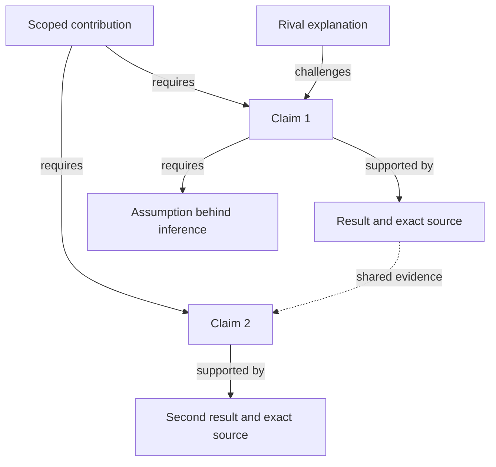

# Argument map and narrative tree

Use stable project IDs where they exist. A Markdown table and Mermaid diagram are usually enough; use structured data only when scale or tooling justifies it. The diagram is a view of the underlying claims, not a second source of truth.

## Node contract

| Node | Essential content |
|---|---|
| Question | Exact original wording and version when available; otherwise label the wording as reconstructed or proposed |
| Hypothesis | Prediction, planned comparison, provenance/timing, and observation that would count against it |
| Evidence | Source path/URL and locator; run/version; observation or estimate; uncertainty, unit, denominator, review status, and exposure where relevant |
| Prior work | Published finding or theoretical premise; bibliographic version/status; inspected passage; scope; resemblance and difference relative to our finding |
| Claim | One proposition; scope; evidence IDs; inference/warrant; important qualifier; current support assessment |
| Assumption | Condition required by a particular inference, with its basis or unresolved status |
| Rival or counterevidence | Competing explanation or conflicting observation; affected claim/edge; what could discriminate |
| Contribution | The paper's justified change to knowledge, with scope and linked claims |
| Reader beat | Reader's question, answer, linked claim IDs, figure/section location, and transition |

Keep provenance, empirical outcome, and interpretation separate. Useful independent fields include:

- `origin`: registration, prospective local plan, amendment, retrospective reconstruction, literature, or new proposal.
- `timing_and_exposure`: actual dates/version pointers and what results/data were already known; unknown stays unknown.
- `execution`: planned, completed, failed, not run, or unavailable.
- `support`: supported within scope, mixed, inconclusive, contradicted, or unassessed.

These are working descriptors, not universal statistical decision rules. Preserve the study's planned rule. An inconclusive estimate and an unexecuted test must not share one “no support” bucket.

## Edge contract

Label arrows with their actual meaning. For support links use evidence → claim; for a readable top-down tree use claim → evidence labeled “supported by.” Keep that convention consistent within one diagram.

| Relation | Meaning |
|---|---|
| motivates | A problem or gap makes a question worth investigating |
| corroborates / extends / qualifies / contradicts | An explicit, justified relationship between our claim and a comparable prior finding or theory; retain material design differences |
| operationalized by | A question/hypothesis is addressed by a specified design or analysis |
| supports / supported by | Evidence bears on a proposition through a stated warrant |
| requires | An inference depends on an assumption or another claim |
| challenges / qualifies | A rival, counterexample, or scope condition limits a claim |
| answers | A warranted claim addresses a question |
| presented in | A claim/evidence item appears in a reader beat or manuscript location |

For jointly necessary evidence, label an AND group. Label alternative sufficient routes OR only when each route independently supports the same scoped claim. Do not count several transformations of the same sample as several independent routes. Keep the support dependency graph free of circular justification; cross-links to alternatives or context need not form a literal tree.

## A compact projection

Put the supporting prose/warrant in the adjacent node record rather than forcing paragraphs into boxes. Show a small overview and separate dense branches if needed. Link to source IDs outside the diagram; shared leaves keep the same ID. Support and challenge relations must remain legible without color.

The reader storyboard is a separate short sequence. Its arrows mean “the reader encounters this next,” not support or causation. Keep causal models in a separately labeled view with their identification assumptions.

## Change propagation

When a source, result, qualifier, or literature finding changes, follow affected claim IDs into the contribution, abstract, section headings, figures/captions, discussion, and presentation. Mark which claims were narrowed, retired, or left unresolved and why. Preserve prior protocol versions. Do not silently delete an awkward branch from the coverage register.
